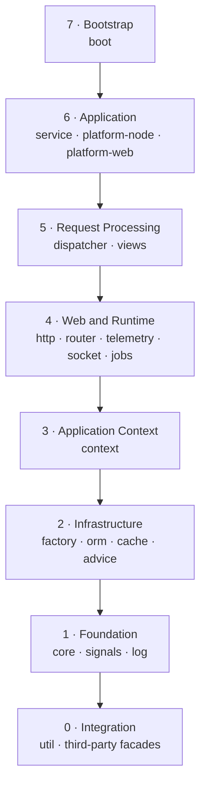

# Ndigo Architecture & Philosophy

Ndigo is a universal JavaScript/TypeScript application framework built on
[inversion of control][fowler-ioc], declarative metadata, a layered object
graph, and platform portability — adapted for the multi-paradigm (OOP + FP)
JavaScript ecosystem.

> **Status:** Ndigo is pre-1.0. The packages are not yet published to npm;
> build from this repository. APIs may change between commits until `1.0.0`.

## Core Philosophy

1. **Universal JavaScript** — the isomorphic core runs in the browser, on
   Node.js, or in a hybrid deployment.
2. **Composition over inheritance** — mixins and function composition instead
   of deep class hierarchies.
3. **Convention over configuration** — sensible defaults with explicit
   overrides.
4. **Bottom-up** — a solid foundation of utility, container, and parser layers
   before application logic.
5. **Test-driven robustness** — behavior is defended by tests, not assumed.

Ndigo favors composition over inheritance, dependency inversion, and
multi-paradigm design. The long-form treatment — SOLID, DRY/AHA, the
Rectangle/Square LSP example, and the pattern catalog — lives in
[Design Principles](./docs/architecture/design-principles.md). For the
industry baseline, see [SOLID][solid] and [DRY][dry].

## The Eight Layers

The framework is organized into eight layers with a single dependency
direction and platform-aware boundaries:

| Layer                      | Responsibility                                                                                                           | Representative packages                                             |
| :------------------------- | :----------------------------------------------------------------------------------------------------------------------- | :------------------------------------------------------------------ |
| **7: Bootstrap**           | Application bootstrap, startup orchestration, context assembly                                                           | `@ndigo/boot`                                                       |
| **6: Application**         | Business services, platform adapters, auth, API docs, MCP projection, clustering, micro-frontend shell, telemetry wiring | `@ndigo/service`, `@ndigo/platform-node`, `@ndigo/platform-web`     |
| **5: Request Processing**  | Front controller, handler execution, view resolution and rendering adapters                                              | `@ndigo/dispatcher`, `@ndigo/view`, `@ndigo/view-webcomponent`      |
| **4: Web & Runtime Infra** | HTTP vocabulary, routing primitives, telemetry, sockets, scheduling, jobs, locks, distributed backends, agent loop       | `@ndigo/http`, `@ndigo/router`, `@ndigo/telemetry`, `@ndigo/socket` |
| **3: Application Context** | Application context, environment, events, configuration metadata                                                         | `@ndigo/context`                                                    |
| **2: Infrastructure**      | IoC container internals, i18n and theming, caching, persistence, advice, resilience, feature flags, rate limiting        | `@ndigo/factory`, `@ndigo/orm`, `@ndigo/advice`, `@ndigo/cache`     |
| **1: Foundation**          | Core primitives, kernel containers, path matching, reactive state, logging core                                          | `@ndigo/core`, `@ndigo/signals`, `@ndigo/log`                       |
| **0: Integration**         | Zero-dependency leaf toolkit, plus stable wrappers around encapsulated third-party libraries                             | `@ndigo/util`, `@ndigo/ai-sdk`, `@ndigo/view-toon`                  |

The full inventory — purpose, platform, and runtime dependencies for every
publishable package — is in [Reference → Packages](https://ndigo.dev/reference/packages/).

### Capabilities at a Glance

The layers are the dependency view; capabilities are the developer view. An
application installs only what it needs:

| Capability           | What it gives an application                                                    | Start with                                                  |
| :------------------- | :------------------------------------------------------------------------------ | :---------------------------------------------------------- |
| HTTP APIs            | Dispatch, binding, validation, Problem Details, OpenAPI, health and metrics     | [Guide 01](./docs/guides/01-building-a-node-api.md)         |
| Browser applications | History routing, DOM view targets, web components, forms, accessibility         | [Guide 02](./docs/guides/02-building-a-browser-app.md)      |
| Reactive state       | Signals, computed values, effects, and the island/SSE bridge                    | [Guide 29](./docs/guides/29-signals-and-islands.md)         |
| Data and persistence | Repository/data-mapper abstractions, Drizzle adapter, migrations, shared stores | [Guide 20](./docs/guides/20-orm-and-migrations.md)          |
| Authentication       | Principals, sessions, password encoders, JWT, OIDC, route guards                | [Guide 26](./docs/guides/26-authentication-and-sessions.md) |
| Observability        | OpenTelemetry logs, metrics, traces, and management endpoints                   | [Guide 32](./docs/guides/32-telemetry.md)                   |
| Background work      | Cron scheduling, durable jobs, the transactional outbox, distributed locks      | [Guide 22](./docs/guides/22-jobs-and-outbox.md)             |
| Feature flags        | Typed evaluation SPI, property-backed provider, `@whenFeature` route gates      | [Guide 34](./docs/guides/34-feature-flags.md)               |
| Agent surfaces       | MCP tools projected from dispatch metadata, MCP Apps, WebMCP, the agent loop    | [Guide 48](./docs/guides/48-agent-facing-surfaces.md)       |
| Micro-frontends      | Hosted feature contexts, islands, shared dependencies, isolated events          | [Micro Frontends](./docs/architecture/micro-frontends.md)   |

### Platform Portability

The isomorphic core (`factory`, `context`, `dispatcher`, `service`, `content`,
and the foundational packages) runs unchanged in browser, Node.js, and hybrid
deployments. Platform differences are isolated in adapters:
`@ndigo/platform-node` owns the HTTP server, static files, multipart, and
graceful shutdown; `@ndigo/platform-web` owns history routing, DOM view
targets, cookies, and browser storage.

This supports three deployment topologies:

1. **Full-browser** — dispatch, service, and view all run client-side.
2. **Hybrid split** — view in the browser, dispatch and service on Node.js.
3. **Configurable split point** — move the boundary as latency, security, and
   UX requirements change.

### Layer Dependencies



Higher layers depend on lower layers, never the reverse. Cross-layer
dependencies inside adjacent tiers are intentional for integration and
orchestration. The stack is acyclic — `pnpm build` fails on any cycle in the
Nx task graph.

## Core Building Blocks

### IoC Container and Lifecycle

Applications are assembled from `@configuration` classes. An `@entry` method
registers its return value as an injectable dependency, so wiring lives next to
the thing it creates:

```typescript
@configuration
class AppConfiguration {
    @property('database.url')
    dbUrl: string;

    @entry
    database() {
        return openDatabase(this.dbUrl);
    }
}
```

Scopes decide reuse: `@singletonScope`, `@prototypeScope`, `@hashScope`, or a
custom `@scope`. The context drives two lifecycle passes:

- **Refresh** — after entries are created, managed lifecycle entries start in
  phase order.
- **Close** — running entries stop in reverse phase order, then every managed
  value is destroyed in reverse creation order.

See [Guide 04 — Injection & Lifecycle](./docs/guides/04-dependency-injection-and-lifecycle.md)
and [Lifecycle & Ownership](./docs/architecture/lifecycle-and-ownership.md).

### Declarative Decorators

Ndigo uses the official [TC39 Stage 3 decorators][tc39-decorators] standard.
Metadata is stored in [`Symbol.metadata`][mdn-symbol-metadata] through
`@tsmetadata/polyfill` — there is no `reflect-metadata` and no
`experimentalDecorators` flag.

Decorators describe intent; the runtime acts on it. The surface spans five
concerns:

| Concern                    | Examples                                                                                           |
| :------------------------- | :------------------------------------------------------------------------------------------------- |
| Configuration and DI       | `@configuration`, `@entry`, `@property`, `@propertySource`, `@whenProfile`                         |
| Request routing            | `@requestMapping`, `@getMapping`, `@postMapping`, `@putMapping`, `@patchMapping`, `@deleteMapping` |
| Lifecycle and scope        | `@scope`, `@singletonScope`, `@prototypeScope`, `@hashScope`                                       |
| Validation and persistence | `@entity`, `@column`, `@primaryColumn`, `@generatedColumn`                                         |
| View resolution            | `@viewMapping`, `@tagMapping`                                                                      |

The full catalog — including advice, metadata, performance, and custom
decorators — is in [Decorators](./docs/architecture/decorators.md).

### Contract-First Design

The framework ships one shared contract vocabulary instead of one per
capability: `Equatable`/`Comparable`/`Comparator`, `Enumerable`, `Serializable`,
`Matchable`, `Parser`/`Stringifier`, `Converter`/`ConversionService`, and the
lifecycle set (`Initializable`, `Destroyable`, `ManagedLifecycle`). Errors carry
their classification: framework and denial errors extend `FrameworkError`,
application-domain failures extend `ApplicationError`, and client errors carry a
structural `problemStatus` and `problemType` URI.

The full working rules — shape guards, comparator primitives, and error
classification — are in
[Design Principles](./docs/architecture/design-principles.md#contract-first-patterns).

### Paradigm Selection Rules

Several facilities can superficially solve the same problem. These rules pick
the canonical one:

| Facility                                                           | Canonical use                                                                             | Anti-pattern                                                                         |
| :----------------------------------------------------------------- | :---------------------------------------------------------------------------------------- | :----------------------------------------------------------------------------------- |
| `@ndigo/signals` (`signal`/`computed`/`effect`)                    | Local, synchronous, derived state within one component or service.                        | Using signals as an asynchronous cross-component event bus.                          |
| `@ndigo/context` `EventEmitter`                                    | Cross-component, asynchronous application events with `:`-hierarchy dispatch.             | Using an emitter for derived state that components read synchronously.               |
| SSE (`ServerSentEventView`, `serviceClient` `stream: true`)        | Server-to-client one-way streams — the island-reactivity channel.                         | Using WebSockets for one-way notifications SSE already covers.                       |
| WebSocket + STOMP (`@socketMapping`, `SocketSession` rooms)        | Bidirectional, session-scoped channels: rooms, broadcasts, heartbeats, cross-node fanout. | Broadcasting application-wide events over a socket instead of the context event bus. |
| Async iterables (`ServiceClient.stream`, `SocketSession.messages`) | Consumer-driven, typed, backpressured iteration over pushed values.                       | Materializing a whole stream into an array before reading it.                        |

**Rule of thumb:** a derived value you read is a signal; something that happened
and others should react to is an event.

[Zod][zod] is the canonical runtime-schema primitive (`safeParse`/`parse` plus
`z.infer`). Schemas validate DTOs, route params, domain value objects, and
signal state; `drizzle-zod` derives entity schemas from `@ndigo/orm` metadata so
persistence, validation, and typing share one definition. See
[Guide 07 — Request Validation](./docs/guides/07-request-validation.md).

### A Minimal Application

A controller is an ordinary class marked with a route prefix; dependencies
arrive through a configuration entry. Nothing is registered by string or global
side effect:

```typescript
import { configuration, entry, property } from '@ndigo/context';
import { getMapping, parameters, pathVariable, requestMapping } from '@ndigo/dispatcher';

class TodoService {
    find(id: string) {
        return { id, title: 'Write the architecture page' };
    }
}

@configuration
class AppConfiguration {
    @entry()
    todoController() {
        return new TodoController(new TodoService());
    }
}

@requestMapping('/todos')
class TodoController {
    constructor(private readonly todos: TodoService) {}

    @getMapping('/:id')
    @parameters({ id: pathVariable('id') })
    findOne(id: string) {
        return this.todos.find(id);
    }
}
```

The preset registers `AppConfiguration`, creates the entry, and the dispatcher
maps `GET /todos/:id` to the handler. Validation, error mapping, and view
resolution are declared the same way and composed by the pipeline.

## Application and Request Lifecycle

### Bootstrap

Platform presets are the default entry point. They register platform
auto-configuration plus the application's `@configuration` classes, prepare the
environment, and refresh the context.

Node:

```typescript
import { createNodeApplication } from '@ndigo/platform-node';

const app = await createNodeApplication([AppConfiguration], { port: 3000 });
```

Browser:

```typescript
import { createWebApplication } from '@ndigo/platform-web';

const app = await createWebApplication([AppConfiguration]);
```

`ApplicationBuilder` remains available when an application must assemble that
sequence manually; `platform: false` opts out of auto-configuration.
`apps/05-ndigo-api` and `apps/10-ndigo-conduit-web` are the reference
implementations for the two presets.

### Request Pipeline

```text
Platform adapter → Dispatcher → handler mapping → interceptors
  → argument resolvers (extractors + conversion) → handler → view or Problem Details
```

- Extractors bound with `@parameters` resolve and type-convert arguments; a
  post-conversion Zod hook runs in every platform resolver.
- Responses: plain objects become JSON; `ResponseEntity` carries explicit
  status, headers, and body; `ModelAndView`/`View` go through view resolution.
- Errors: the adapter hands off to the dispatch error path, then the
  `RouteErrorResolver` chain; the last-resort resolver guarantees a
  deterministic status for anything unhandled.

Platform adapters plug in at both ends: the adapter package owns transport and
argument extraction, while the isomorphic dispatcher owns mapping,
interception, and resolution. [Guide 00 — Core Concepts](./docs/guides/00-core-concepts.md)
walks the full sequence.

### HTTP Error Contract

Every 4xx/5xx response is an [`application/problem+json`][rfc9457] document:
`type`, `title`, `status`, `detail`, `instance`, plus an `errors` extension for
validation issues. Status conventions are canonical — 400 binding,
401 with `WWW-Authenticate`, 403, 404, 405 with `Allow`, 415, 422 validation,
429, and 503, with 500 as the last resort. See
[Guide 08 — Errors & Problem Details](./docs/guides/08-errors-and-problem-details.md).

## Cross-Cutting Concerns

**Configuration and environments.** Property sources resolve in a fixed
precedence order, profiles select environment-specific layers, and
`@configurationProperties` binds typed objects; validation fails loudly at
startup. See [Environment & Configuration](./docs/architecture/environment.md)
and [Guide 03](./docs/guides/03-environment-configuration.md).

**Security.** Trust boundaries are explicit: the platform adapter establishes
request identity, guards enforce authentication and authorization, and the
problem contract never leaks internals. See
[Security](./docs/architecture/security.md) and
[Guide 28](./docs/guides/28-security-hardening.md).

**Observability.** Logging, metrics, and tracing share one
[OpenTelemetry][otel] surface; Node and browser wiring live in separate adapter
packages, and `@ndigo/mcp` projects agent tools from the same dispatch
metadata ([Model Context Protocol][mcp]). See
[Guide 32](./docs/guides/32-telemetry.md).

**Testing.** `@ndigo/test` drives the real dispatcher in-process (MockMVC
style), so integration tests exercise routing, binding, validation, and
serialization without opening a socket. See
[Guide 36](./docs/guides/36-testing.md).

## Where to Go Next

- [Guides](./docs/guides/README.md) — start with [Guide 00](docs/guides/00-core-concepts.md) for the mental model,
  then [Guide 01](docs/guides/01-building-a-node-api.md) (Node) or [Guide 02](docs/guides/02-building-a-browser-app.md) (browser).
- [Reference → Packages](https://ndigo.dev/reference/packages/) — the generated
  package inventory.
- [Design Principles](./docs/architecture/design-principles.md) — SOLID, DRY,
  patterns, and contracts.
- [Decorators](./docs/architecture/decorators.md) — the declarative surface.
- [Lifecycle & Ownership](./docs/architecture/lifecycle-and-ownership.md) —
  initialization, shutdown, and resource ownership.
- [Security](./docs/architecture/security.md) and
  [Agent-First](./docs/architecture/agent-first.md) — the trust model and the
  agent-facing architecture.

---

_© 2026 Ndigo Team. All rights reserved._

[fowler-ioc]: https://martinfowler.com/bliki/InversionOfControl.html
[solid]: https://en.wikipedia.org/wiki/SOLID
[dry]: https://en.wikipedia.org/wiki/Don%27t_repeat_yourself
[tc39-decorators]: https://github.com/tc39/proposal-decorators
[mdn-symbol-metadata]: https://developer.mozilla.org/en-US/docs/Web/JavaScript/Reference/Global_Objects/Symbol/metadata
[rfc9457]: https://www.rfc-editor.org/rfc/rfc9457.html
[zod]: https://zod.dev
[otel]: https://opentelemetry.io/docs/
[mcp]: https://modelcontextprotocol.io/specification
