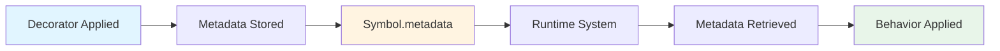

# Decorators

The declarative surface: how Ndigo turns TC39 Stage 3 decorators into configuration, routing, lifecycle, validation, and view wiring.

### Overview

Decorators are a metaprogramming feature in JavaScript and TypeScript that allow behavior to be added to classes, methods, fields, or parameters at design time. They are functions that are invoked with the decorated item as an argument, enabling them to inspect, modify, or even replace the target.

In Ndigo, decorators are the primary mechanism for achieving **separation of concerns** and **reducing boilerplate**. They enable a declarative programming style where complex, cross-cutting logic—such as routing, dependency injection, and lifecycle management—is cleanly separated from core business logic. This directly supports the [Single Responsibility Principle](./design-principles.md#single-responsibility-principle-srp) by allowing each class to focus on its core purpose while decorators handle cross-cutting concerns.

By annotating a class or its members, you instruct the framework to apply specific behaviors, turning complex imperative setup into a simple, readable declaration. This is all accomplished using the official **TC39 Stage 3 decorator** standard, ensuring future compatibility and adherence to the JavaScript language evolution.

### Decorators in Ndigo

Ndigo's decorator surface spans the core packages, each decorator addressing a common cross-cutting concern. Their key benefits include:

- **Declarative Configuration**: Define component behavior with simple annotations instead of complex setup code.
- **Metadata-Driven**: Decorators attach metadata to classes, which the framework uses at runtime to wire together behavior.
- **Separation of Concerns**: Keep routing, validation, and lifecycle logic out of your business components.
- **Reduced Boilerplate**: Eliminate repetitive setup code for common tasks like component registration and dependency wiring.

### Cross-Cutting Concerns

Ndigo decorators are organized around five key cross-cutting concerns:

#### 1. Configuration & Dependency Injection

These decorators manage application configuration and dependency injection, allowing components to receive their dependencies and configuration properties without needing to know where they come from.

- **Decorators**: `@configuration`, `@entry`, `@property`, `@propertySource`, `@whenProfile`
- **Problem Solved**: Eliminates manual dependency wiring, external configuration loading, and factory management.

**Example:**

```typescript
@configuration
class AppConfig {
    @property('database.url')
    dbUrl: string;

    @entry
    databaseConnection() {
        // This method's return value is automatically registered
        // as an injectable dependency in the application context.
        return new DatabaseConnection(this.dbUrl);
    }
}
```

#### 2. Request Routing & Dispatching

These decorators map incoming requests (e.g., HTTP requests) to specific controller methods, simplifying the creation of APIs and web controllers.

- **Decorators**: `@requestMapping`, `@getMapping`, `@postMapping`, `@putMapping`, `@patchMapping`, `@deleteMapping`, `@queryMapping`, `@errorMapping`, `@errorHandler`
- **Problem Solved**: Removes the need for manual route tables or large switch statements. Provides a declarative way to handle routing and errors.

**Example:**

```typescript
@requestMapping('/api/users')
class UserController {
    @getMapping('/:id')
    getUserById(@pathVariable('id') id: string) {
        return this.userService.findById(id);
    }

    @errorHandler(UserNotFoundError)
    handleNotFound(error: UserNotFoundError) {
        return { status: 404, message: error.message };
    }
}
```

#### 3. Lifecycle & Scope Management

These decorators control the instantiation and lifecycle of objects within the application context, defining whether an object is a singleton, a new instance per request, etc.

- **Decorators**: `@scope`, `@singletonScope`, `@prototypeScope`, `@hashScope`
- **Problem Solved**: Manages object lifecycles automatically, ensuring predictable and efficient use of resources.

**Example:**

```typescript
@singletonScope
class UserService {
    // A single instance of UserService is shared across the entire application.
}

@prototypeScope
class RequestHandler {
    // A new instance of RequestHandler is created for each request.
}
```

#### 4. Data Validation

Entity decorators carry validation metadata that the framework derives into a Zod schema — validation logic is co-located with the field it protects, and the derived schema is the single source of truth.

- **Decorators**: `@column({ schema })`, `@primaryColumn`, `@generatedColumn`
- **Problem Solved**: Keeps validation with the data it protects while producing a runtime schema _and_ a static type (`z.infer`) from one declaration. Route params use `validatedBy(schema, dataBinderValue('query'))` from `@ndigo/dispatcher`; domain components override `validationSchemas`.

**Example:**

```typescript
import { z } from 'zod';
import { entity, column, primaryColumn } from '@ndigo/orm';

@entity('users')
class User {
    @primaryColumn()
    id: number;

    @column({ type: 'varchar', schema: z.string().email() })
    email: string;

    @column({ type: 'varchar', schema: z.string().regex(/^[A-Za-z\s]+$/) })
    name: string;
}
```

#### 5. View Resolution

View decorators link components to their corresponding view templates or custom element tags, simplifying UI rendering.

- **Decorators**: `@viewMapping`, `@tagMapping`
- **Problem Solved**: Automates the registration of UI components and their association with specific views or DOM elements.

**Example:**

```typescript
@viewMapping('user-profile')
@tagMapping('user-profile')
class UserProfileComponent extends HTMLElement {
    // This class is automatically registered as the <user-profile>
    // custom element and linked to the 'user-profile' view.
}
```

### Decorator Metadata

Ndigo decorators work by attaching metadata to classes, which is then read by the framework at runtime. This process follows the TC39 standard, using the `Symbol.metadata` property on class constructors.

The flow is as follows:



**Metadata Keys**: To avoid collisions and provide a clear structure, metadata keys follow a consistent pattern:

| Pattern                    | Example                      | Usage                 |
| -------------------------- | ---------------------------- | --------------------- |
| `concern:type`             | `'route:mapping'`            | Class-level metadata  |
| `concern:type:member`      | `'route:mapping:getUser'`    | Method-level metadata |
| `concern:parameter:member` | `'method:parameter:getUser'` | Parameter metadata    |

**MetadataManager**: The `@ndigo/dispatcher` package provides a `MetadataManager` class that efficiently scans, caches (in a `WeakMap`), and retrieves this metadata, acting as the bridge between declarative decorators and the framework's runtime behavior.

### Performance Considerations

While decorators are powerful, they introduce a small amount of overhead at class definition time. To ensure optimal performance, follow these best practices:

✅ **Do:**

- Keep decorator functions lightweight and focused on storing simple metadata values.
- Defer expensive logic (e.g., compiling a regex, fetching data) to the runtime components that consume the metadata.
- Use caching (like the `WeakMap` in `MetadataManager`) for repeated metadata access.

❌ **Don't:**

- Perform heavy computations or I/O operations inside a decorator function.
- Store large, complex objects or instances directly in metadata.
- Create unnecessary decorator instances in loops or high-frequency code paths.

**Example:**

```typescript
// ✅ Good: Lightweight metadata storage
function route(path: string) {
    return function (target, context) {
        // Only stores a simple string in metadata.
        context.metadata['route:path'] = path;
        return target;
    };
}

// ❌ Bad: Heavy computation at class definition time
function route(path: string) {
    return function (target, context) {
        // Don't compile regex or fetch data here! This runs
        // every time a class with this decorator is defined.
        const compiledPattern = compileComplexRoutePattern(path);
        context.metadata['route:path'] = compiledPattern;
        return target;
    };
}
```

### Creating Custom Decorators

To create a custom decorator compatible with Ndigo, adhere to the following:

1.  **Follow the TC39 Signature**: Ensure your decorator function matches the standard signature (e.g., `(target, context)`).
2.  **Use `context.metadata`**: Store metadata on the provided `context.metadata` object.
3.  **Follow Key Conventions**: Use the `concern:type:member` naming pattern for metadata keys.
4.  **Keep it Lightweight**: Defer heavy logic to a runtime processor that reads the metadata.

**Minimal Example:**

```typescript
export function customDecorator(value: string) {
    return function (target: any, context: ClassDecoratorContext) {
        context.metadata['custom:value'] = value;
        return target;
    };
}
```

### Standards Compliance

Ndigo is fully compliant with modern JavaScript standards for decorators:

- **TC39 Stage 3 Decorators**: All framework decorators use the official TC39 Stage 3 decorator specification.
- **`Symbol.metadata`**: Metadata is stored in the standard `Symbol.metadata` property.
- **`@tsmetadata/polyfill`**: This polyfill is used to ensure `Symbol.metadata` is available across all supported JavaScript environments, providing a seamless and standards-compliant experience.
