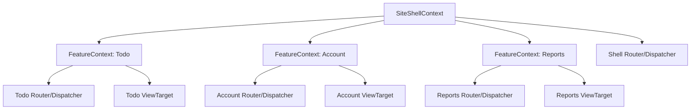

# 2026-03-24 Scale 2 Context + Routing Architecture

**Date:** 2026-03-24  
**Status:** ✅ Complete  
**Priority:** High  
**Context:** BlueJS multi-context/site architecture for micro-frontends and route partitioning  
**Dependencies:** `@blue/context`, `@blue/router`, `@blue/dispatcher`, `@blue/view`, `@blue/view-webcomponent`

---

## Executive Summary

Scale 1 (TodoMVC) validated the bidirectional view flow in a single flat `ApplicationContext`:

1. Controller → View (`BrowserDispatcher` renders via `ViewTarget`)
2. View → Service (`ViewTarget` forwards mapped DOM events to context events)
3. Service → Controller/View (`router.refresh()` re-dispatches current route)

Scale 2 extends this to **multi-context applications** (site shell + isolated feature/micro-frontend contexts) while preserving:

- deterministic event flow,
- strict context ownership,
- route-level composition,
- and predictable lifecycle teardown.

---

## Scope and Goals

### In scope

1. **Hierarchical context boundaries**

    - Site shell root context owns shared infrastructure (router, dispatcher, telemetry, theme/language).
    - Feature contexts own feature services, view targets, and feature-local events.

2. **Micro-frontend event isolation**

    - Feature contexts handle feature-local user events without leaking globally by default.
    - Explicit gateway mappings are required for cross-context communication.

3. **Site-level routing composition**
    - Shell router resolves top-level route partition (feature mount).
    - Feature routers resolve feature-local sub-routes.

### Implemented in this plan so far

1. **Event gateway foundation** in `@blue/context`

    - `ContextEventGateway` for explicit allowlisted source→target relays.
    - Unit tests for relay behavior, dynamic registration, and destroy semantics.

2. **Site router partitioning baseline** in `@blue/router`

    - `SiteRouter` mounts feature callbacks on route prefixes.
    - `refresh()` replays current mounted route callback.

3. **Route partition helpers** in `@blue/router`

    - `normalizePartitionPrefix`, `matchesPartitionPath`, `stripPartitionPrefix`, `restorePartitionPrefix`.
    - Unit tests for partition matching and shell↔feature route mapping.

4. **Hierarchical context composition helpers** in `@blue/context`

    - `createShellContext`, `createFeatureContext`.
    - Traversal/search helpers: `traverseToRoot`, `traverseSubtree`, `findAncestor`, `findDescendants`.
    - Unit tests covering parent/child composition and relay wiring via `ContextEventGateway`.

5. **Demo shell/feature composition wiring** in `apps/blue-demo`

    - Added `shell-composition.ts` to compose `site-shell` + `todo` feature context relationship.
    - Added site partition mount for `/todo/**` with feature-local route dispatch.
    - Updated demo startup and view route links to use shell-prefixed paths via route partition helpers.
    - Added demo tests for shell route mapping and partition mount behavior.

6. **Context gateway hardening foundation** in `@blue/context`

    - Added optional `ContextEventGatewayOptions` with validation strategy + diagnostics handler.
    - Added namespace validator strategy (`NamespaceRelayValidationStrategy`) for `site:*` + feature namespace contracts.
    - Added blocked relay tracking (`blockedRelays`, `hasBlockedRelays`) and optional throw-on-invalid behavior (`InvalidRelayError`).
    - Added tests for blocked diagnostics, throw behavior, and allowed namespaced relay flows.

7. **Teardown policy + telemetry integration**

    - Added `unmountFeatureContext(feature, policy)` with `preserve` (default) and `close` policies.
    - Added tests for both unmount policies and gateway option pass-through in `context-hierarchy`.
    - Integrated gateway diagnostic logging in demo runtime composition (`blue-demo:shell-composition`) with structured relay registration/blocked logs.
    - Added demo composition test coverage for runtime relay gateway setup.

8. **Feature mount manager abstraction** in `@blue/context`

    - Added `FeatureContextMountManager` for feature registration, mount/unmount/remount orchestration.
    - Supports unmount policy-aware behavior (`preserve` reuses feature context, `close` recreates on next mount).
    - Preserves gateway validation/diagnostic option behavior across remount cycles.
    - Added integration-style tests for mount/unmount churn under both policies.

9. **Runtime mount manager integration** in demo shell

    - Integrated `FeatureContextMountManager` into `composeTodoRuntime` as the source of feature lifecycle truth.
    - Added explicit route-driven unmount behavior when shell route is outside `/todo/**` partition.
    - Added custom context factory support in `createFeatureContext` for runtime-owned feature contexts.
    - Added tests for route-outside-partition unmount behavior and custom context factory support.

10. **Diagnostics counters + multi-feature simulation tests**

    - Added relay metric counters on `ContextEventGateway`: `activeRelayCount`, `blockedRelayCount`, `relayedEventCount`.
    - Added gateway tests for counter behavior under valid/blocked relay flows.
    - Added demo runtime metrics logging on feature mount/unmount.
    - Added multi-feature mount churn test (`todo` preserve + `account` close) to validate isolated lifecycle behavior.

11. **Shell feature routing registry abstraction** in demo runtime

    - Added `ShellFeatureRoutingRegistry` to declaratively bind route partitions to mount-manager lifecycle.
    - Added duplicate-binding safety and active-feature deactivation behavior.
    - Integrated into `composeTodoRuntime` so shell routing no longer manually orchestrates feature activation/deactivation inline.
    - Added dedicated tests for binding behavior and deactivation on unmatched routes.

12. **Second feature partition integration (`/account`)** in demo runtime

    - Added account feature registration in `FeatureContextMountManager` with `close` unmount policy.
    - Bound `/account/**` partition in `ShellFeatureRoutingRegistry` and verified lifecycle switching with `/todo/**`.
    - Added shell route helpers (`ACCOUNT_ROUTE_PREFIX`, `toAccountShellRoute`) and account link in demo UI.
    - Added tests for account route mapping and cross-partition mount/unmount transitions.

13. **Promoted routing registry to package-level utility (`@blue/router`)**

    - Extended `FeatureRoutingRegistry` with `setActiveFeature(name)` for explicit activation control.
    - Refactored demo shell composition to use `FeatureRoutingRegistry` directly instead of demo-local registry wrapper.
    - Updated demo integration tests to validate `FeatureRoutingRegistry` + mount-manager orchestration.
    - Removed demo-local registry implementation file to avoid duplicate abstractions.

14. **Account feature render flow implemented in demo**

    - Added `AccountController` with `/account` and `/account/settings` handlers.
    - Added `account-app` Web Component view with section-aware rendering and shell links.
    - Registered account controller/view in demo context configuration.
    - Updated account partition route handling to dispatch through `BrowserDispatcher`.
    - Added controller + view tests for account route models and DOM rendering behavior.

15. **Activation policy extension in `FeatureRoutingRegistry`**
    - Added registry options with configurable activation policy (`tracked` default, `exclusive`).
    - `exclusive` policy deactivates all non-target features on activation.
    - Added tests for both activation policies and explicit active-feature behavior.

### Out of scope (this phase)

- Distributed runtime federation/loading (remote module transport)
- Cross-tab/shared-worker event buses
- SSR/edge rendering strategy

---

## Architecture Decisions

| Decision                    | Chosen approach                                 | Rationale                                                    |
| --------------------------- | ----------------------------------------------- | ------------------------------------------------------------ |
| Context topology            | Parent/child `ApplicationContext` tree          | Reuses existing context model (`children`, `parent`, bubble) |
| Event isolation default     | Local-only handling in feature contexts         | Prevents accidental coupling and event storms                |
| Cross-context communication | Explicit gateway map (allowlisted event relays) | Auditable and secure boundaries                              |
| Route composition           | Site shell partition + feature sub-route        | Keeps shell concerns separate from feature internals         |
| Lifecycle teardown          | Context close cascades to child contexts        | Aligns with current `ApplicationContext.close()` semantics   |

---

## Target Topology

---

## Event Isolation Model

### Rule 1: Local first

Feature UI events are emitted and handled inside the feature context:

- `todo:user:created`
- `todo:user:toggled`
- `todo:user:removed`

No broadcast/bubble outside feature context unless explicitly relayed.

### Rule 2: Explicit relay

Cross-context events must be relayed through an allowlisted gateway map:

- feature event → shell event (upward)
- shell command → feature event (downward)

Example:

- `todo:stats:updated` (feature) → `site:nav:badge:update` (shell)

### Rule 3: Namespaced contracts

All shared/boundary events use site-wide namespaces:

- `site:*` for shell-owned channels
- `<feature>:*` for feature-owned channels

---

## Routing Model

### Site route partition

Shell resolves feature mount prefix:

- `/todo/**` → Todo feature context
- `/account/**` → Account feature context
- `/reports/**` → Reports feature context

### Feature route ownership

Feature router receives only sub-route within partition:

- Shell route `/todo/active` → Todo feature route `/active`

### Refresh semantics

- Feature service mutation calls **feature router** `refresh()`.
- Shell-level state change calls shell router `refresh()`.

---

## Lifecycle Model

1. Shell creates feature context on first mount (or eagerly if configured).
2. Feature context refresh initializes feature beans.
3. Route rendering uses feature-owned `ViewTarget` and event map.
4. Route transition away from feature may:
    - keep feature context warm (cache policy), or
    - close feature context (strict isolation policy).
5. `close()` cascades destroy through feature beans and listeners.

---

## Phased Implementation Plan

### Phase 3.1 — Foundation (non-breaking)

1. Add docs and naming contracts for shell/feature namespaces.
2. Define package-owned context tokens for shell primitives (`ROUTER`, `DISPATCHER`, `VIEW_TARGET`) as follow-up to typed keys.
3. Add optional gateway abstraction for allowlisted event relays between parent/child contexts.

### Phase 3.2 — Site + feature routing composition

1. Introduce shell route partition adapter (prefix strip/restore behavior). ✅
2. Add feature-router mounting API and tests.
3. Validate `refresh()` semantics for nested routers.

### Phase 3.3 — Isolation hardening

1. Enforce event namespace conventions in gateway registration.
2. Add diagnostics hooks for blocked relays.
3. Add teardown policy options (warm cache vs close on unmount).

---

## Risks and Mitigations

| Risk                                  | Mitigation                                                          |
| ------------------------------------- | ------------------------------------------------------------------- |
| Event leakage across feature domains  | Default deny relay policy + allowlisted mappings                    |
| Route ambiguity between shell/feature | Prefix partition contract + explicit mount table                    |
| Memory growth from warm contexts      | Configurable teardown policy; leverage `ApplicationContext.close()` |
| Over-coupling to shell internals      | Package-owned tokens + namespaced event contracts                   |

---

## Success Criteria

1. Feature contexts can be mounted/unmounted without cross-feature event bleed.
2. Shell can compose multiple feature routers under stable route partitions.
3. Feature-local `router.refresh()` updates only feature-owned rendering flow.
4. Lifecycle teardown closes listeners/resources cleanly for unmounted features.

---

## Completion Notes

All planned Scale 2 primitives have been implemented and validated:

- Typed context tokens with `ContextToken<T>`
- Hierarchical shell/feature contexts with event gateway isolation
- Site router partitioning and feature routing registry
- Feature mount/unmount orchestration with preserve/close policies
- Activation policies (tracked/exclusive)
- Per-feature telemetry with `FeatureMetricAggregator`, `CounterRateResolver`, and `@counted` decorator
- Demo integration: multi-feature (`/todo`, `/account`) with shared metrics panel

Future work (latency tracking, histogram buckets, sliding-window rates) is tracked independently in `@blue/telemetry` package scope.
