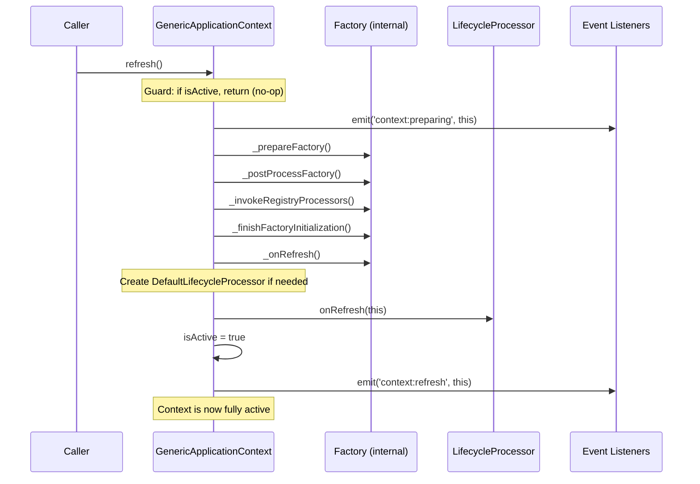
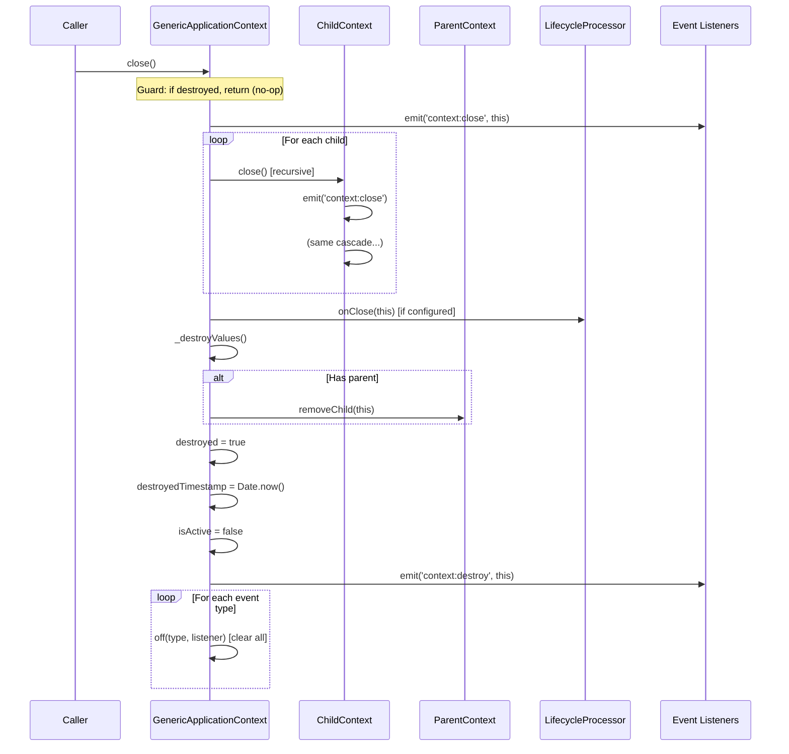

# Application Context Lifecycle

**Date:** 2026-08-22  
**Scope:** `@ndigo/context` — `GenericApplicationContext`, `ContextEventGateway`, `EventEmitter`  
**Status:** Reference

---

## 1. Overview

The `GenericApplicationContext` follows a two-phase lifecycle:

1. **Refresh** — activates the context, initializes factories, runs processors
2. **Close** — deactivates, destroys values, cascades to children, clears listeners

A context can be refreshed once and closed once. Repeated calls are safe no-ops. Once closed, a context is permanently destroyed.

---

## 2. Refresh Sequence



**Key invariants:**

- Calling `refresh()` on an already-active context is a safe no-op (`isActive` guard)
- `context:preparing` fires before any factory initialization
- `context:refresh` fires after all initialization is complete and `isActive` is set
- Lifecycle events are emitted synchronously — listeners run during the `emit()` call

---

## 3. Close Sequence



**Key invariants:**

- Calling `close()` on an already-destroyed context is a safe no-op (`destroyed` guard)
- `context:close` fires on the closing context before children are closed
- Children are closed recursively, depth-first, before the parent's own cleanup
- `context:destroy` fires after all cleanup is complete and `destroyed` is set
- After `close()`, the context cannot be reused — `refresh()` will check `isActive` but `_prepareContext` creates a new `MetadataConfigApplicationContext` per run

---

## 4. Destroy vs Close

`destroy()` is a convenience alias for `close()`:

```
destroy() → close()
```

Both are safe to call multiple times — the `destroyed` guard prevents re-entrance.

---

## 5. Child Context Lifecycle

### 5.1 Creation

```
parent.newChild('childName') → GenericApplicationContext
```

- The child is added to `parent.children`
- The child's `parent` property points to the parent
- The child starts in inactive state (`isActive = false`)

### 5.2 Close Propagation

When a parent closes:

1. `context:close` fires on the parent
2. Each child is closed recursively (depth-first)
3. Each child removes itself from its parent's children list
4. After all children are closed, the parent runs its own cleanup

### 5.3 Re-parenting

```
child.setParent(newParent)
```

- `setParent` removes the child from the old parent's children list and adds it to the new parent
- Re-parenting does not change the child's active state
- `path` and `root` recompute on access

---

## 6. Event Addressing

A context is a local event emitter. Cross-context notification is explicit:

| Scope                   | API                                                               |
| ----------------------- | ----------------------------------------------------------------- |
| Local                   | `context.emit(type, ...data)`                                     |
| Shared root channel     | `context.root.emit(type, ...data)`; listeners use `root.on(...)`  |
| Child → direct owner    | `context.parent?.emit(type, ...data)`                             |
| Owner → direct children | `for (const child of context.children) child.emit(type, ...data)` |
| Isolated relay          | `ContextEventGateway(source, target, relays)`                     |

- No recursive propagation is built into the context API; a deeper walk is application code.
- `children` is plural: a shell may host several live features.
- A listener registered on `root` must be removed on close. `ContextEventGateway` owns its subscriptions and `destroy()` detaches them.
- `ContextEventGateway` relays selected events and supports namespace validation (`NamespaceRelayValidationStrategy`); `createFeatureContext()` uses it for shell/feature event flow.

---

## 7. Lifecycle Event Summary

| Event               | Fires                | Purpose                               |
| ------------------- | -------------------- | ------------------------------------- |
| `context:preparing` | Start of `refresh()` | Factory initialization about to begin |
| `context:refresh`   | End of `refresh()`   | Context is fully active               |
| `context:close`     | Start of `close()`   | Teardown starting                     |
| `context:destroy`   | End of `close()`     | Context is fully destroyed            |

---

## 8. State Transitions

```
                    ┌─────────────┐
                    │  Created    │
                    │ (inactive)  │
                    └──────┬──────┘
                           │ refresh()
                           ▼
                    ┌─────────────┐
             ┌─────▶│   Active    │◀──────────────┐
             │      │ (isActive)  │                │
             │      └──────┬──────┘                │
             │             │ close()               │ refresh() [no-op]
             │             ▼                       │
             │      ┌─────────────┐                │
             │      │  Destroyed  │────────────────┘
             │      │ (destroyed) │
             │      └─────────────┘
             │             │ close() [no-op]
             │             ▼
             │      ┌─────────────┐
             └──────│  Destroyed  │
                    │  (still)    │
                    └─────────────┘
```

---

## 9. Test Coverage

The lifecycle is covered by the following tests in `context.spec.ts` and `context-edge-cases.spec.ts`:

| Test                                                               | File                       | Description                                                     |
| ------------------------------------------------------------------ | -------------------------- | --------------------------------------------------------------- |
| `it should refresh and initialize constructor entries`             | context.spec.ts            | `refresh()` initializes constructor entries                     |
| `it should refresh only once when already active`                  | context.spec.ts            | Repeated `refresh()` is a no-op                                 |
| `it should run registry processors during refresh`                 | context.spec.ts            | `EntryRegistryProcessor` runs during refresh                    |
| `it should emit lifecycle events during refresh and close`         | context.spec.ts            | Correct event ordering: `preparing → refresh → close → destroy` |
| `it should close and cascade destruction to child contexts`        | context.spec.ts            | Close propagates to children                                    |
| `it should close only once when already destroyed`                 | context.spec.ts            | Repeated `close()` is a no-op                                   |
| `close propagates to grandchildren (depth > 1)`                    | context-edge-cases.spec.ts | Close cascades through multiple levels                          |
| `close removes the context from its parent children list`          | context-edge-cases.spec.ts | Parent-child bookkeeping                                        |
| `close on a never-refreshed context completes`                     | context-edge-cases.spec.ts | Close works without prior refresh                               |
| `repeated close on already-closed child is no-op`                  | context-edge-cases.spec.ts | Idempotent close                                                |
| `removeChild returns false when child is not in children list`     | context-edge-cases.spec.ts | Edge case for missing child                                     |
| `it should keep local events local to the emitting context`        | context.spec.ts            | `emit` does not reach the parent                                |
| `it should use the root context as the shared channel`             | context.spec.ts            | Cross-context events are addressed through `root`               |
| `it should address a direct parent explicitly`                     | context.spec.ts            | `parent.emit` is one level, not a climb                         |
| `it should address direct children without reaching grandchildren` | context.spec.ts            | The `children` loop is one level, not a broadcast               |
